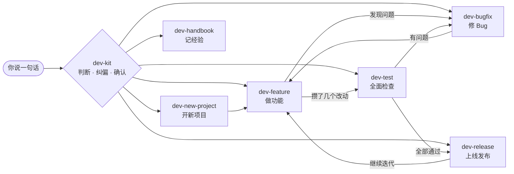

<p align="center">
  
</p>

<h1 align="center">dev-kit</h1>

<p align="center">给编程新手的 AI 开发工具箱：你只管说想做什么，它帮你判断该怎么做、带你一步步做完。</p>

<p align="center">
  适用于 Cursor Agent Skills ·
  也可用于 Claude Code ·
  中文
</p>

---

## 这是什么

用 AI 写代码，最难的往往不是写代码，而是**不知道下一步该干什么、该怎么跟 AI 说**。比如：

- 想做个小工具，一上来就让 AI 做十个功能，最后什么都改不动
- 说"修个 bug"，其实是想要一个原来就没有的功能
- 没测试就上线，数据一刷新全没了
- 同一个问题来回让 AI 改了五遍，越改越乱

dev-kit 是一组 Cursor Agent Skills（给 AI 看的流程说明书），把"做一个个人小项目"的全过程做成了**询问式的工作流**：

1. **听懂你的意图**：你随口说"我要开发个项目""这里报错了""想上线"就行
2. **看现场**：检查项目文件夹、有没有没存档的改动、进度文档里有没有遗留问题
3. **帮你纠偏**：发现你的判断不太对，会直接指出来并给建议
4. **跟你确认**：说清楚它打算用哪个流程、会做哪几步，你点"开始"才动手
5. **带你走完**：每一步标出进度，需要你拍板的地方会停下来问你
6. **推荐下一步**：做完一件事，告诉你接下来最该做什么

## 用起来是什么样

```text
你：我要开发个项目，记录每天读的书

AI：我理解你想要：从零做一个读书记录的小网页
    判断理由：当前文件夹是空的，你描述的是一个独立的新东西
    我会用 dev-new-project 带你做：
      补齐一页需求 → 搭项目骨架 → 生成项目规矩和进度文档 → 第一次存档
    开始吗？
    [开始]  [不对，其实是给现有项目加功能]  [先聊聊]
```

它会帮你挡住这些坑：

```text
你：帮我修个 bug，待办列表不能按日期排序
AI：待办列表原本就没有排序功能，这不算 bug，而是新功能。
    建议用 dev-feature 来做，这样会先跟你确认排序规则。要换成这个吗？

你：可以上线了吧
AI：你上次测试之后又改了 3 处，而且还有没存档的改动。
    建议先用 dev-test 全面检查一遍，通过了再上线。

你：再改一下，还是报错
AI：这个问题已经改了 3 次还没好。建议先退回到修改前的版本，
    新开一个对话换个思路，不然越改越乱。
```

## 工具箱里有什么

| 技能 | 作用 | 什么时候用 |
| --- | --- | --- |
| **dev-kit** | 总入口：识别意图、纠偏、确认、调用下面的流程、推荐下一步 | 一直在，你直接说话就会触发 |
| dev-new-project | 从零开一个新项目：收窄需求、搭骨架、生成项目文件、首次存档 | "我要做一个……" |
| dev-feature | 迭代一个功能：问清需求、讲方案、实现、验收、存档 | "加个功能""改一下这个页面" |
| dev-bugfix | 修 Bug：复现、找根因、最小修复、回归检查 | "报错了""白屏""点了没反应" |
| dev-test | 全面检查：构建、验收清单、刷新/窄屏/空数据检查，输出报告 | "测试一下""检查有没有问题" |
| dev-release | 上线发布：发布前检查、版本号、部署、回滚方法 | "上线""发布""不想每次开终端" |
| dev-handbook | 把新经验记进你的飞书开发手册 | "记进手册" |

## 工作流



## 安装

需要先装好 [Cursor](https://cursor.com) 和 Git。

```sh
git clone https://github.com/hyejeongwong-max/dev-kit.git
cd dev-kit
./install.sh
```

脚本会把 7 个技能复制到 `~/.cursor/skills/`，所有项目都能用。装好后**新开一个对话**（或重启 Cursor）生效。

同时给 Claude Code 用：

```sh
./install.sh --claude
```

更新到最新版：

```sh
cd dev-kit
git pull
./install.sh
```

## 怎么用

三种方式，从省事到精确：

1. **直接说话**（推荐）：在 Cursor 的 Agent 对话里说"我要开发个项目""这里报错了""想上线"，dev-kit 会自动接手。
2. **打开菜单**：输入 `/dev-kit`，从六个场景里选，或者选"我也说不清，帮我判断"。
3. **跳过确认**：已经很确定时，直接输入子流程，比如 `/dev-bugfix 点了添加按钮没反应`。

## 新项目默认会得到什么

用 dev-new-project 建的项目会自带三个文件，让 AI 在以后的每个新对话里都知道项目的情况：

| 文件 | 作用 |
| --- | --- |
| `AGENTS.md` | 给 AI 的项目规矩：技术栈、改代码的规矩、设计规范 |
| `docs/进度.md` | 做完了什么、数据存在哪、已知问题、下一步打算 |
| `docs/验收清单.md` | 每个功能怎么验证，提交前和上线前照着点一遍 |

默认技术栈是 Vite + React + TypeScript，数据先存在浏览器里，不需要后端和登录。你有别的要求时，跟 AI 说就行。

## 可选：飞书开发手册

dev-handbook 会把开发中学到的经验写进一篇飞书文档，越用越厚。要用的话：

1. 安装飞书官方命令行工具并登录（[官方说明](https://open.feishu.cn/document/mcp_open_tools/feishu-cli-let-ai-actually-do-your-work-in-feishu)）：

   ```sh
   npm install -g @larksuite/cli
   lark-cli config init
   lark-cli auth login
   ```

2. 打开 `skills/dev-handbook/SKILL.md`，把"配置"里的手册链接和文档 ID 换成你自己的飞书文档，再运行一次 `./install.sh`。

不用飞书的话可以跳过，其他六个技能不受影响。

## 自定义

所有流程都是普通的 Markdown 文件，放在 `skills/<技能名>/SKILL.md`。想改流程，直接改这些文件，再运行 `./install.sh`。也可以让 AI 帮你改，比如："修改 dev-feature：每次提交前先给我看改动摘要。"

## 目录结构

```text
dev-kit/
├── README.md
├── install.sh                # 安装脚本
├── assets/icon.svg           # 图标
└── skills/
    ├── dev-kit/              # 总入口：意图识别、纠偏、确认、调度
    ├── dev-new-project/      # 含 templates.md：AGENTS.md / 进度 / 验收清单模板
    ├── dev-feature/
    ├── dev-bugfix/
    ├── dev-test/
    ├── dev-release/
    └── dev-handbook/
```

## License

[MIT](LICENSE)
